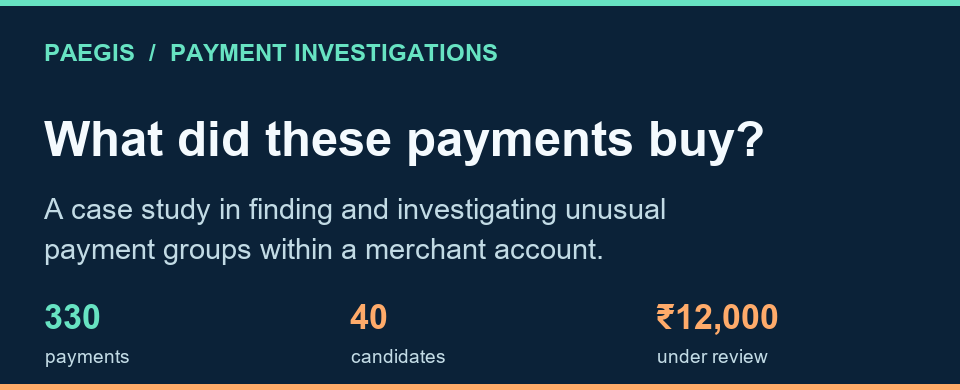
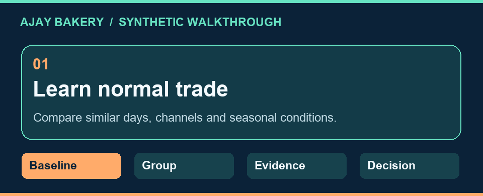
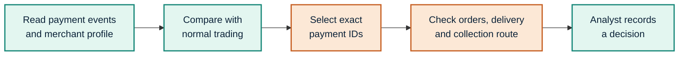

  

# PAEGIS

**Help a payments risk analyst identify the exact payments that need an explanation and check what they bought.**

A legitimate merchant account can collect ordinary sales and payments for a different purpose. The ledger may show the same merchant ID and amount for both. PAEGIS proposes a post-onboarding investigation workflow that finds an unusual group within the account and builds a case around those specific payments.

[Walkthrough](#the-bakery-case) · [Workflow](#how-paegis-works) · [Decision](#what-the-analyst-decides) · [Pilot](#what-the-pilot-must-prove)

## The bakery case

  

| What the ledger shows | What PAEGIS sends to review | What remains for the analyst |
| :--- | :--- | :--- |
| **330 payments**, **₹99,000** collected, **₹300** average ticket | **40 candidate IDs**, **₹12,000** in selected value, and the reasons they surfaced | Check whether the payments match actual orders, fulfilment, and the merchant’s declared business |

Ajay Bakery is a synthetic case. The other 290 payments form a comparison population. A promotion, festival or catering order could explain unusual timing.

## How PAEGIS works

1. **Learn normal trade.** Compare matching weekdays, channels and seasonal conditions. Track unusual counts, persistent changes and changes in the mix of payment amounts.
2. **Find recurring groups.** Examine permitted payer labels across payment windows. Return exact IDs and test how often a similarly large group appears when payer labels are shuffled within each day.
3. **Gather targeted evidence.** Request itemised orders, delivery or collection records, and checkout details tied to sampled IDs. Record gaps where data is unavailable.
4. **Review the explanation.** The analyst checks whether independent records support or contradict the merchant’s account and logs the outcome and rationale.

## What the analyst decides

| Evidence | Response |
| :--- | :--- |
| Orders and fulfilment support the explanation | **Clear** the case and record the evidence. |
| The explanation remains unresolved | **Monitor** and request the missing records. |
| Verified evidence conflicts with the declared business purpose | **Escalate** through authorised policy channels and match the scope of action to the evidence. |

## What the pilot must prove

| Stage | Evidence needed to proceed |
| :--- | :--- |
| **Inventory** | Identify usable payment history, stable identifiers and authorised evidence sources. |
| **Prototype** | Run the synthetic case from ingestion through a recorded analyst decision. |
| **Historical replay** | Compare PAEGIS and existing alerts over the same period with equal analyst capacity. |
| **Shadow pilot** | Measure supported findings per analyst hour, alert delay, false alerts, evidence requests and coverage before considering enforcement. |

**Project status:** Case-study documentation and an illustrated walkthrough of the proposed design. The synthetic case illustrates the workflow. Operational outcomes require a pilot.
